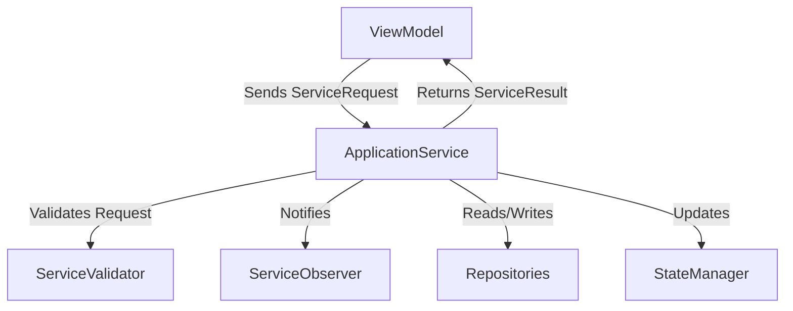

# Application Services Architecture

Establish the Application Service layer responsible for orchestrating repositories, state management, and future feature workflows in ClaudeWatch.

## Purpose

The Application Service layer acts as the coordinator between the Presentation (ViewModels) and Infrastructure (Repositories, State observers, Core device APIs) layers. By placing this layer at the core of the app:
1. **Separation of Concerns**: ViewModels focus purely on UI state rendering and UI events; they never direct repositories directly.
2. **Framework Independence**: The application service code is written in pure Dart, independent of Flutter UI components or reactive UI packages.
3. **Reusability**: Different ViewModels (e.g. Mobile Dashboard vs. Wearable view) can invoke the exact same orchestration flows.

---

## Responsibilities

- **Orchestration**: Directing repository data fetches, saving updates, and updating centralized states.
- **Workflow State Management**: Monitoring and updating execution context, status outcomes (e.g., handling offline transitions gracefully).
- **Validation**: Enforcing pre-execution constraints on request inputs and post-execution constraints on response outputs.
- **Observer Notification**: Supplying hooks for diagnostics, performance, tracking, and logs.

---

## Lifecycle

Every service lifecycle progresses through a structured sequence:
1. `Created`: The service is instantiated.
2. `Initialized`: Metadata context is injected via `initialize(context)`.
3. `Ready`: The service is idle and prepared to handle execution requests.
4. `Executing`: An operation is running.
5. `Completed` or `Failed`: The operation concludes, optionally transitioning back to `Ready`.
6. `Disposed`: Resources are cleared.

Invalid state transitions (e.g., trying to execute a service that has been disposed or not initialized) throw a `StateError`.

---

## Architecture Interactions

### Interaction with ViewModels
- ViewModels call `service.execute(request)` to trigger feature workflows.
- ViewModels receive a structured `ApplicationServiceResult<T>` containing status (e.g., success, failure, offline, partial) and unpack it to update the screen state.

### Interaction with Repositories
- Services invoke repository actions (e.g. `saveSettings()`, `fetchHistory()`).
- Repositories are strictly responsible for raw database/persistent access and are unaware of service orchestration logic.

### Interaction with State
- Services update cross-cutting states (e.g., updating a global connection health state or logging a metric) via observers or state controllers.

---

## Future Extensibility

To add a new service:
1. Define a specific service request/response structure.
2. Extend `BaseApplicationService` and override the `execute` method to write feature orchestration logic.
3. Register the service in the bootstrapper Core/Feature modules to enable constructor injection.
